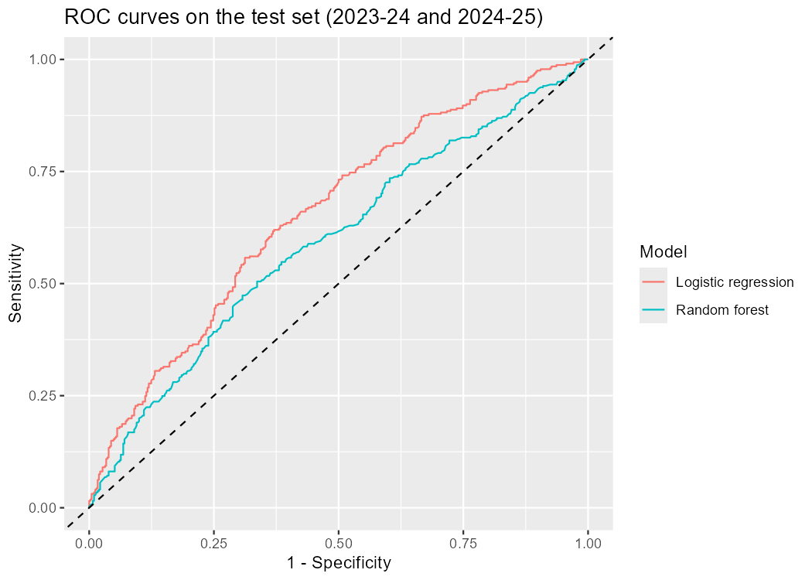
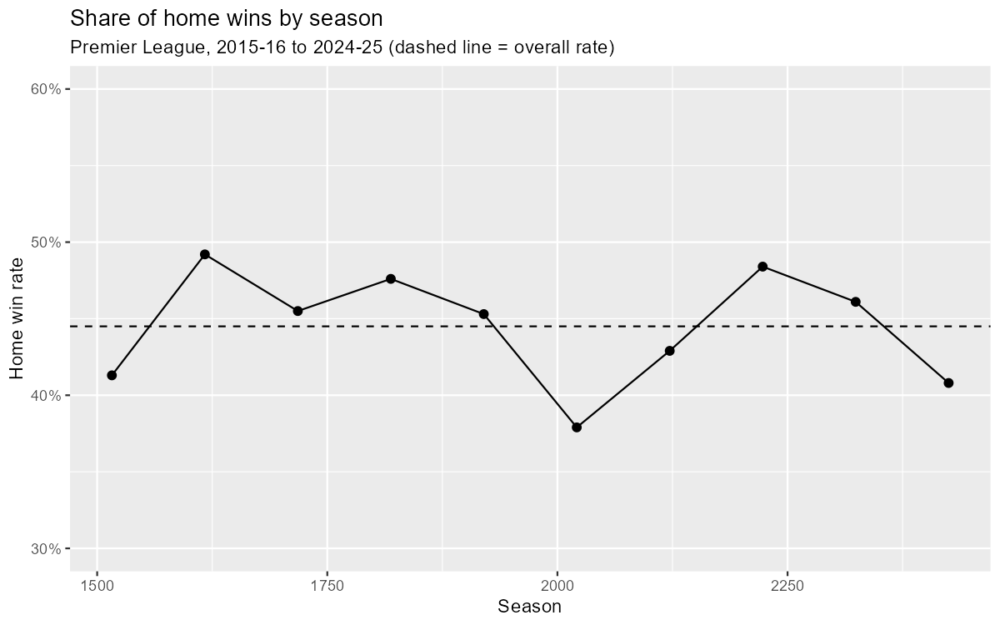

# Football Match Predictor: Can Recent Form Predict Home Wins in the Premier League?

Binary classification project predicting whether the home team wins a Premier League match, using only information available before kick-off (recent form of both teams).

## Research question
Can the recent form of two teams (points and goal difference over their previous five matches) predict home wins better than a naive baseline?

## Data
3,800 Premier League matches, seasons 2015-16 to 2024-25, from [football-data.co.uk](https://www.football-data.co.uk/). After computing five-match form, 3,620 matches are kept.

## Methods
- Leak-free features: average points and goal difference over the previous five matches, for each team.
- Chronological split: training on 2015-16 to 2022-23 (2,889 matches), test on 2023-24 and 2024-25 (731 matches).
- Models: logistic regression and random forest.
- Evaluation: accuracy against a majority-class baseline (exact binomial test), precision, recall, F1, ROC-AUC with DeLong confidence intervals.

## Key findings

| Model (threshold 0.5) | Accuracy | ROC-AUC (95% CI) |
|---|---|---|
| Baseline (always "no home win") | 56.1% | - |
| Logistic regression | **61.1%** (p = 0.003) | **0.657** (0.618-0.697) |
| Random forest | 59.4% (p = 0.04) | 0.593 (0.552-0.635) |

- Recent form predicts home wins better than the naive baseline, but the gain is modest (about 5 percentage points of accuracy).
- The logistic regression outperforms the random forest (DeLong test on AUC, p = 0.0015).
- Only the goal-difference features are individually significant in the logistic regression (odds ratios 1.44 for the home team and 0.61 for the away team).




## Limitations
- Only recent form is used (no squad quality, injuries, ratings or bookmaker odds).
- The target merges draws with away wins.
- Small test set and non-independent matches: p-values and intervals are probably optimistic.
- No hyperparameter tuning or rolling cross-validation; one league and ten seasons.
- Not a betting tool.

## Reproduce
Install the R packages `tidyverse`, `pROC`, `randomForest`, `knitr` and `rmarkdown`, then run:

```r
source("scripts/run_all.R")
```

The full report is generated in `reports/final_report.html`.

## Project structure
- `scripts/`: numbered R scripts (download, exploration, features, split, models, evaluation) and `run_all.R`
- `data/raw/` and `data/processed/`: downloaded and processed data
- `results/`: figures, model objects and the evaluation table
- `reports/final_report.Rmd`: full report